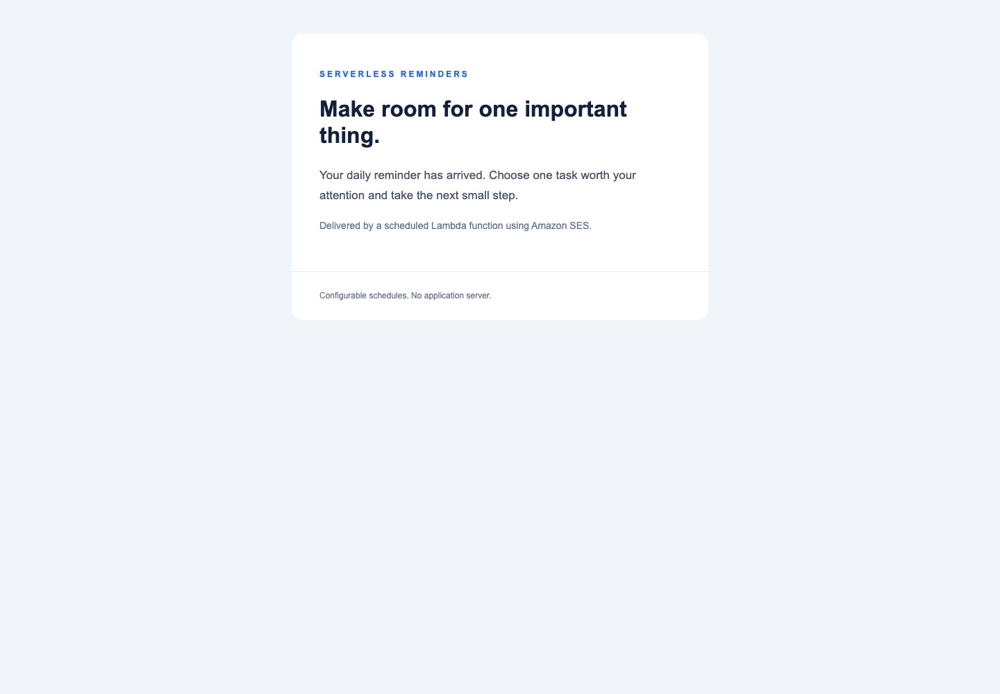

# Serverless Reminders

[](https://github.com/einnor/serverless-reminders/actions/workflows/ci.yml)

Scheduled email reminders built with TypeScript, AWS Lambda, EventBridge schedule rules and Amazon SES. A small event-driven application with no continuously running application server.



The image is an **offline HTML preview** of the real email template. No email was sent and no AWS deployment was performed to create it.

## Architecture and decisions

EventBridge invokes one of two async Lambda handlers. Each renders a Pug template, inlines CSS and submits a `SendEmailCommand` through AWS SDK v3. Sender and recipients come from environment variables, not source code.

The handler returns the delivery promise and allows errors to propagate, rather than reporting completion while work is still in flight. SES acceptance is not the same as inbox delivery. IAM grants `ses:SendEmail` for a configured identity instead of all SES operations.

| Function | Schedule | Meaning |
| --- | --- | --- |
| `dailyReminder` | `rate(1 day)` | Every 24 hours, relative to rule creation |
| `weekendReminder` | `cron(30 22 ? * SUN,SAT *)` | Saturdays and Sundays at 22:30 **UTC** |

These are EventBridge **rules**, not the newer timezone-aware EventBridge Scheduler resource. AWS cron has six fields, including year; it is not Unix five-field cron.

## Local preview: no AWS account needed

Requires Node.js 24 and npm.

```sh
git clone https://github.com/einnor/serverless-reminders.git
cd serverless-reminders
npm ci
npm test
npm run preview
```

Open `docs/preview/daily-reminder.html` or `docs/preview/weekend-reminder.html`. These generated files are ignored. Rendering uses local templates only and never calls SES.

## Deploy deliberately

Deployment creates AWS resources and can incur charges. It is not part of CI. You need AWS credentials, a verified SES identity in the deployment region, and Serverless Framework v4 authentication/licensing appropriate to your use.

```sh
cp .env.example .env
# Edit the addresses and identity, then export them into your shell.
set -a
. ./.env
set +a

npm run package -- --region eu-west-1 --stage dev
npm run deploy -- --region eu-west-1 --stage dev
```

| Variable | Purpose |
| --- | --- |
| `REMINDER_FROM` | Sender address authorized by the SES identity |
| `REMINDER_TO` | Comma-separated recipient addresses |
| `SES_IDENTITY` | Verified sender domain or email used in the IAM resource ARN |
| `AWS_REGION` | Region for direct SDK use; Lambda supplies its deployment region |

In the SES sandbox, recipients must also be verified. Obtain production sending access before emailing arbitrary recipients. Never put AWS access keys in the repository. Review the resolved configuration and package before deployment.

Remove resources when finished:

```sh
npx serverless remove --region eu-west-1 --stage dev
```

## Verification and operational boundaries

Tests compile TypeScript, render both templates, inspect the SES request using an injected client, reject missing configuration and verify that delivery errors reject the promise. CI runs these checks without cloud credentials. Cloud provisioning and end-to-end SES delivery require separate validation in your AWS account.

Scheduled delivery is **at least once**. This implementation has no deduplication store, so retries may produce duplicate reminders. Before using it for consequential notifications, add an idempotency key/store, failure destination or dead-letter queue, and alarms for errors, throttling and delivery failures. Log retention is set to 14 days; recipients are not written to application logs.

The project began as a Serverless scheduling learning exercise using the Woof Garden/Pluralsight example. The refresh replaces personal addresses and remote-image templates, moves from Node.js 10/AWS SDK v2 to Node.js 24/SDK v3, and adds offline verification without claiming production operation.
